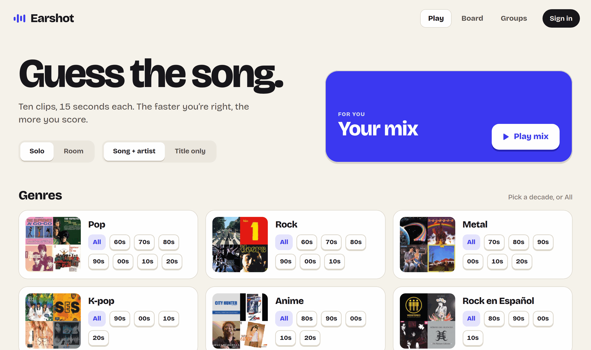

<p align="center">
  <a href="https://earshot.rising.sh"></a>
</p>

# Earshot

Guess the song from a 15-second clip, alone or with friends. Earshot runs in the
browser at <https://earshot.rising.sh>; there is nothing to install.

[](https://codecov.io/gh/risinghq/earshot.rising.sh)



- **Solo:** ten rounds from a genre, a decade, or a mix built from your own
  listening. The faster you answer, the more the round is worth.
- **Room:** start a room and share its code or link. Up to 8 players answer on
  their own phones, and every round starts on every device at once.
- **Match:** get paired with a stranger who picked the same genre.
- **TV:** open a room on a big screen. It plays the clip and shows the code, the
  round and the scores, while the phones take the answers.
- **Profile:** signed-in players keep their points on the weekly board, join
  groups with friends, and get a public listening profile at `/u/NAME`, with
  JSON at `/u/NAME.json` and a card for a README at `/u/NAME.svg`.

This repository also holds [music-stats](docs/music-stats.md), a command that
writes your most played tracks to a GitHub Gist:

```sh
cargo install music-stats
```

- [Manual](docs/readme.md)
- [Contributing](.github/contributing.md)
- [License](LICENSE)

Earshot is a [rising.sh](https://rising.sh) project.
